**English** · [Русский](README.ru.md)

# Signals

Filter banks, wavelets and Toeplitz matrices in C++ with an interactive terminal interface. It shows filter responses, the bank's block diagram, every band of a decomposition, each processing step and the theory behind each method, and 66 auto-checked tasks lead from convolution to denoising.


The project rewrites an older Python library, `SignalProc` (2023); its code is kept in `legacy/python/` for comparison.

## Install

macOS and Linux:

```bash
curl -fsSL https://raw.githubusercontent.com/VIA-s-acc/SignalProc/main/install.sh | sh
```

Windows, in PowerShell:

```powershell
irm https://raw.githubusercontent.com/VIA-s-acc/SignalProc/main/install.ps1 | iex
```

Homebrew, on macOS and Linux:

```bash
brew install VIA-s-acc/signals/signals
```

The script takes the build of the latest release, checks its checksum and installs into your home folder, without `sudo`: `~/.local/bin/signals` on macOS and Linux, `%LOCALAPPDATA%\Programs\signals` on Windows. It also installs the man page and completions for bash and fish, and prints the line to add to `~/.zshrc` for zsh. Running it again updates the program. To pick a version or a folder: `… | sh -s -- --version v0.8.0 --dir ~/bin`; on Windows, the variables `SIGNALS_VERSION` and `SIGNALS_INSTALL_DIR`.

### By hand

Builds are on the [Releases](https://github.com/VIA-s-acc/SignalProc/releases) page.

| System | Archive |
|---|---|
| macOS 14 or newer, Apple Silicon and Intel | `signals-vX.Y.Z-macos-universal.tar.gz` (up to 0.8.0: `macos-arm64`, Apple Silicon only) |
| Linux x86_64, glibc 2.28 or newer (Ubuntu 20.04, Debian 10, RHEL 8) | `signals-vX.Y.Z-linux-x86_64.tar.gz` |
| Windows 10 and 11, x86_64 | `signals-vX.Y.Z-windows-x86_64.zip` |

An archive holds `signals` (`signals.exe` on Windows), the READMEs and the licence, and from 0.9.0 also `man/signals.1` and `completions/`. Checksums are in `SHA256SUMS`. The macOS build is not signed: Gatekeeper refuses a file downloaded by a browser until the quarantine flag is removed with `xattr -d com.apple.quarantine signals`. The script and Homebrew take care of that.

### Build from source

You need CMake 3.28 or newer and a C++23 compiler: Apple Clang 17, GCC 14 or MSVC from Visual Studio 2026.

```bash
cmake --preset release
cmake --build --preset release
build/release/app/signals
```

## First steps

`signals` in a terminal opens the interface. On the first start a start panel offers:

- **Example: denoising** — the Pipeline tab with a ready graph: a noisy Doppler signal cleaned with wavelets, the probes `noisy` and `clean` show before and after;
- **Learning path: task 0.1** — the first auto-checked task;
- **Open your own audio file** — WAV, FLAC or MP3 on the Signal tab.

The palette (`:`) opens the panel again: Start panel. The terminal needs at least 80×24; the layout is designed for 150×44. The interface, the book and the help are in English and Russian: `signals --lang ru`, the variable `SIGNALS_LANG=ru` or the palette command Language: Russian.

Without the interface:

```bash
signals check                         # self-check of the core
signals filter info db4               # coefficients, delay, smoothness
signals learn                         # chapters and tasks of the learning path
signals run examples/denoise.sig      # run a processing graph
```

## Screens

Digits `1`–`9` switch tabs, `[` `]` switch sub-tabs, `?` lists every key of the screen, `F1` opens the theory of whatever has focus. The keys of all screens are collected in [docs/user/keys.en.md](docs/user/keys.en.md).

### Signal

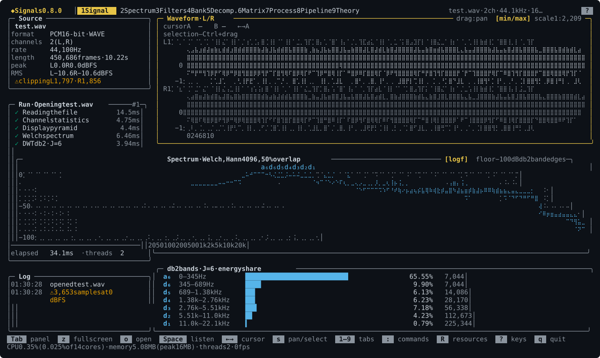

Source and channel statistics, loading stages, an L/R waveform with cursors and selection, a Welch spectrum, energy shares of the db2 bands, playback.

### Spectrum

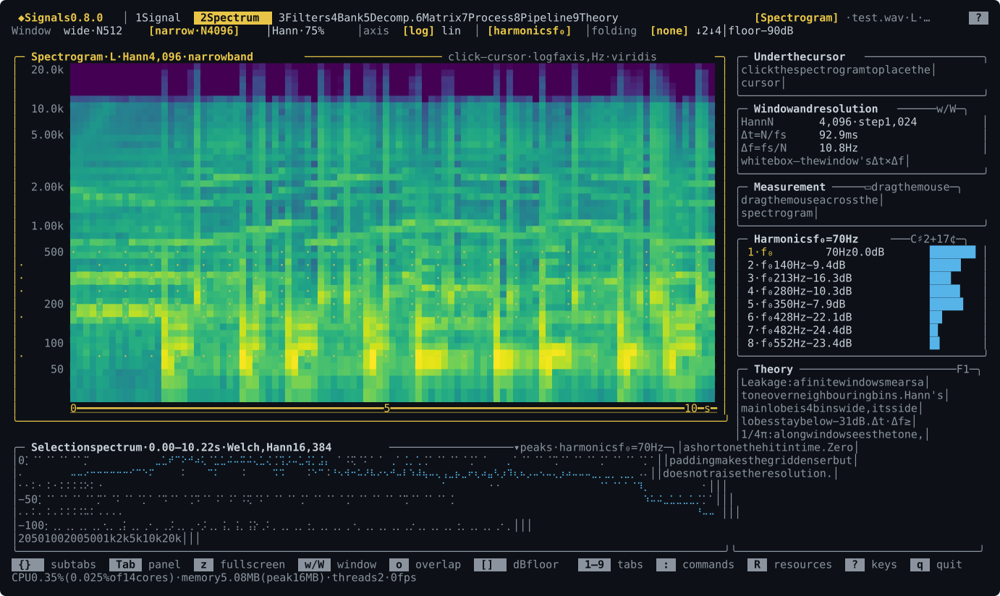

STFT, the spectrum of a selection, peaks, fundamental and harmonics. Sub-tabs: Resampling — where the spectrum folds under ↓M, ↑L and L/M — and Tone and time — stretching without changing pitch, and pitch shifting.

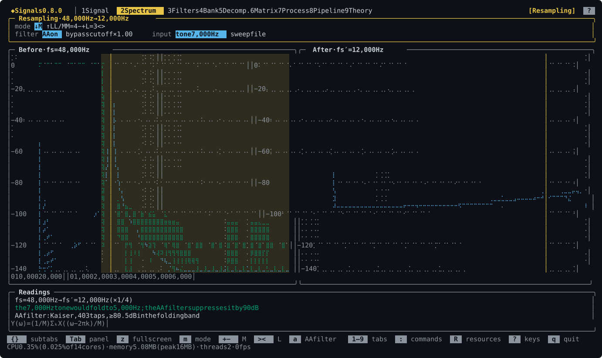

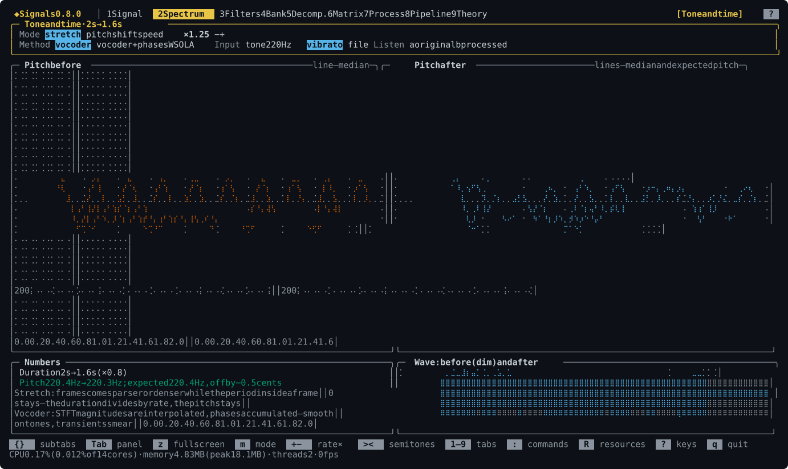

### Filters

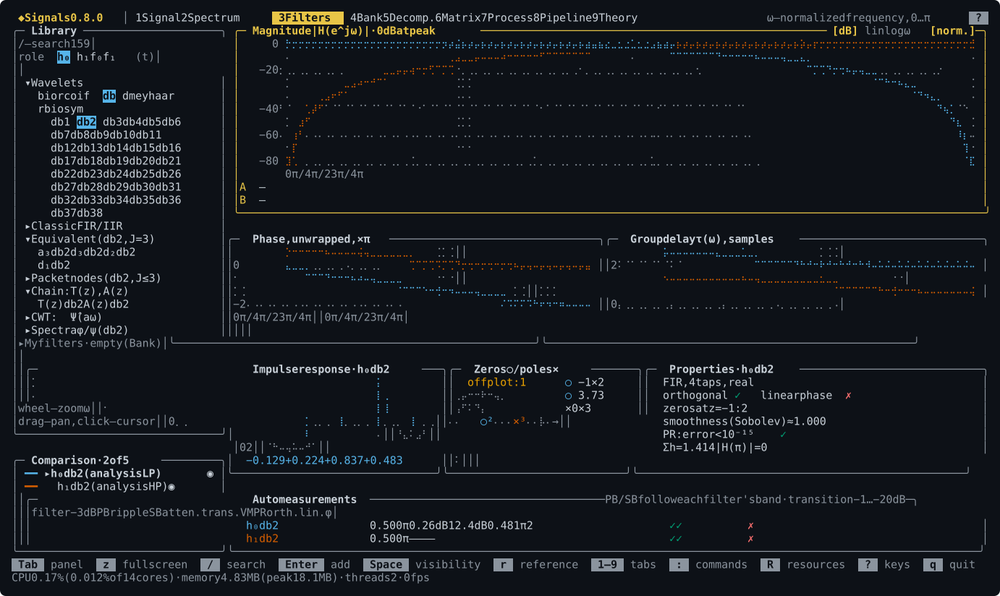

All 106 PyWavelets wavelets, equivalent band filters, up to five filters compared: magnitude, phase, group delay, impulse response, and zeros and poles you can drag with the mouse.

### Bank


Designer splits the half-band P₀(z) into H₀ and F₀ by its roots and checks perfect reconstruction; Diagram shows the bank with a probe on any wire. Below, the key `n` steps through the factorizations.


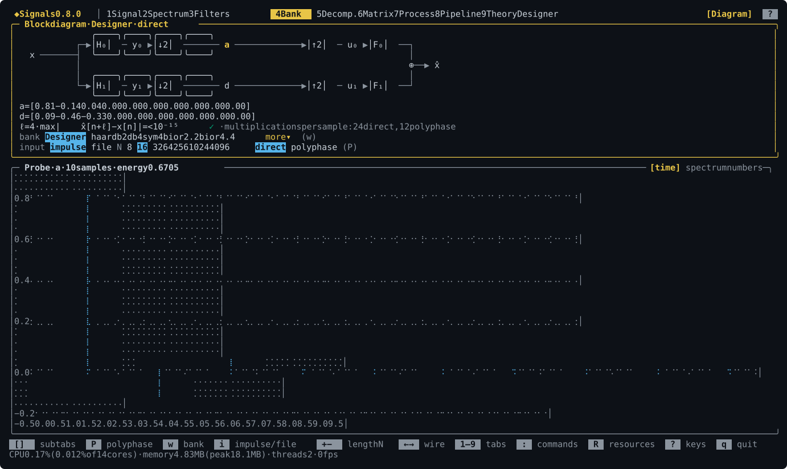

### Decomposition

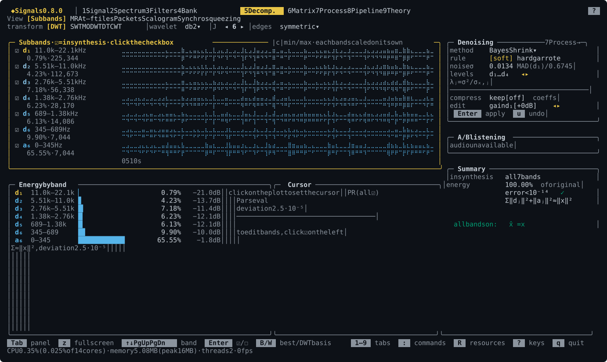

DWT, SWT, MODWT and DTCWT of the signal: subbands, MRA, time–frequency tiles, packets, scalogram and synchrosqueezing, denoising and band editing with playback.

### Matrix

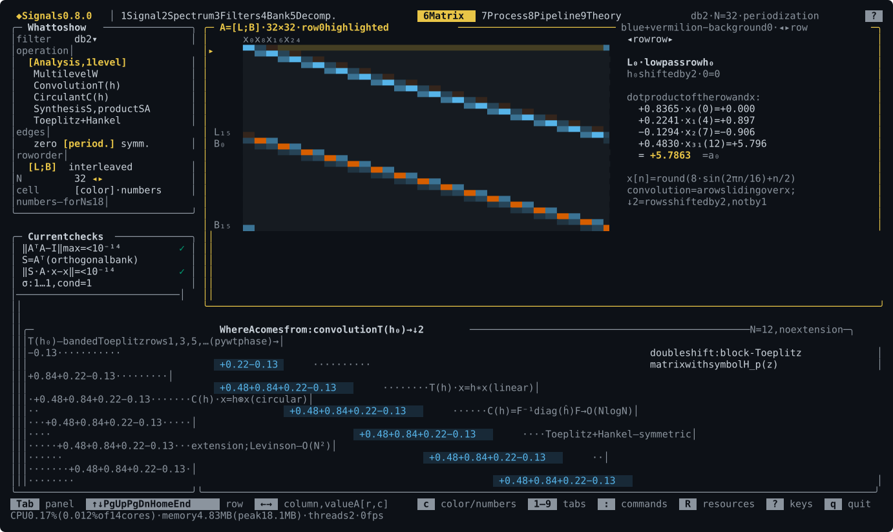

The bank's Toeplitz matrices, the multilevel W, checks of AᵀA = I and singular values.

### Processing

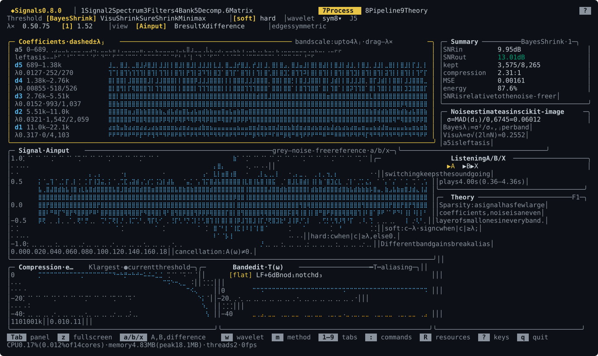

Denoising a fragment against a clean reference: Bayes, Visu, SURE and Minimax rules, soft and hard thresholds, the shrinkage curve, A/B/X listening.

### Pipeline

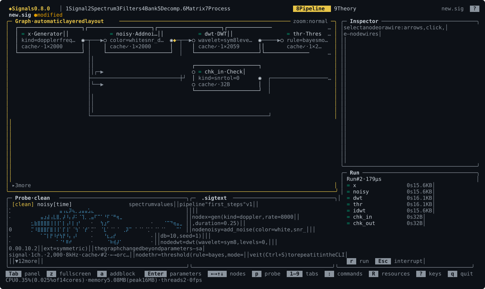

An editor of `.sig` graphs built from 136 blocks: the graph lays itself out, every node shows the time and memory of its last run, probes show a signal, a spectrum or numbers.


### Theory

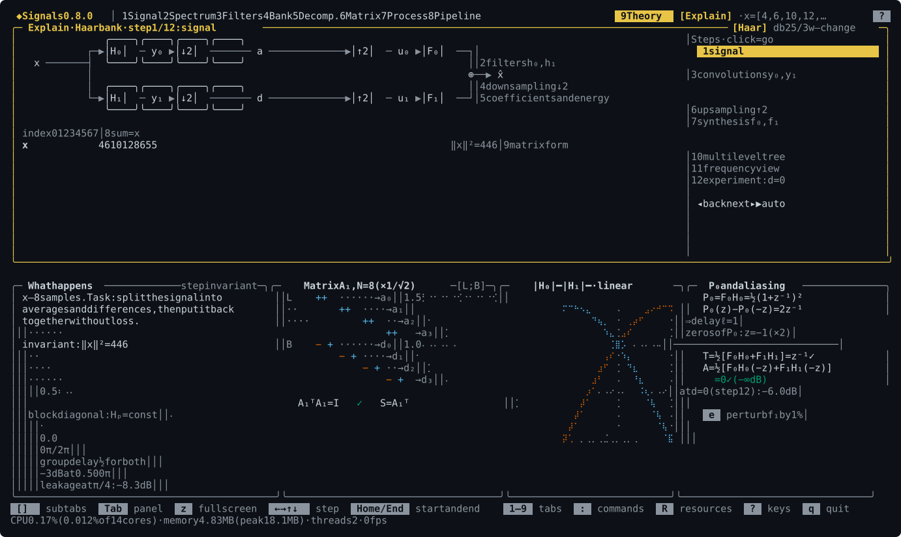

Explain walks the Haar bank step by step with the numbers in every node. Under the hood has a card for every block: formulas, the same formulas with the numbers of the open file, and the code of the key function. Tutorial is the book, with sections, search and formulas.

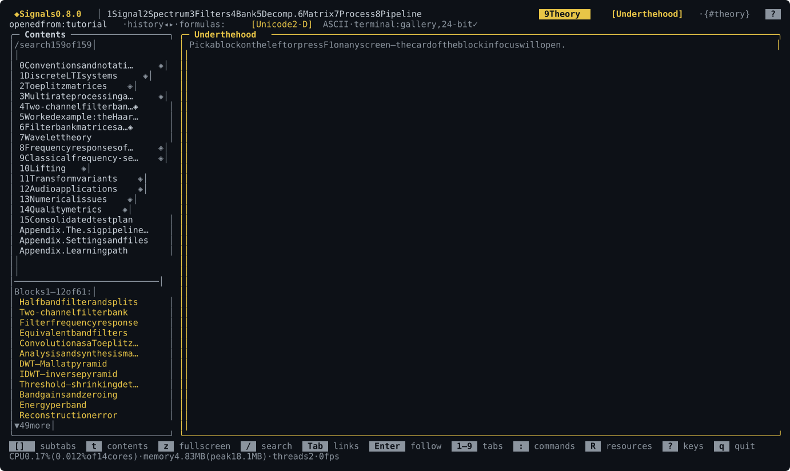

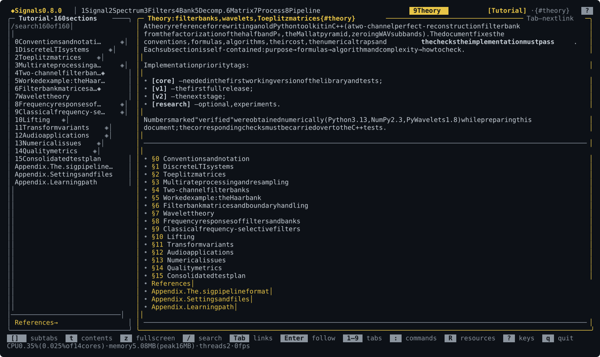

### Tasks

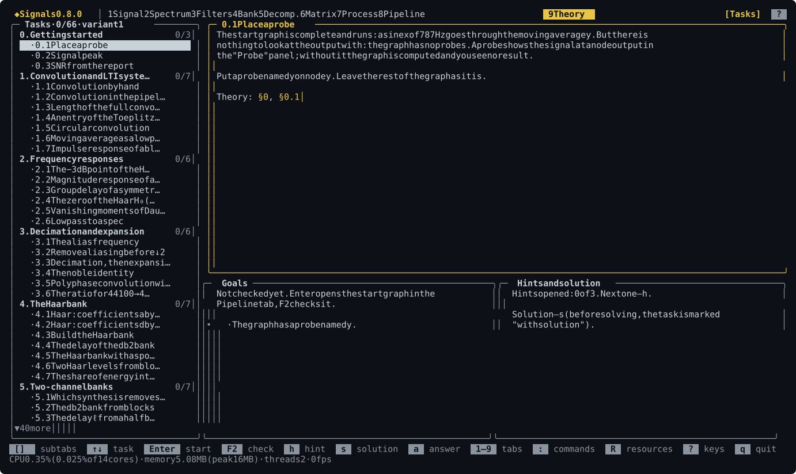

The learning path: 66 tasks in 12 chapters, each checked by the program itself. `F2` checks the current task from any tab, `F3` opens a hint.


## Commands

Messages are in English or Russian: `--lang ru` anywhere in a command, or `SIGNALS_LANG=ru`. Commands that print a report accept `--json`; `--help` on every command lists its options.

| Command | What it does |
|---|---|
| `signals check` | self-check of the core: reconstruction, orthogonality, Parseval, power complementarity, matrices |
| `signals filter info <name>` | coefficients h₀, h₁, f₀, f₁, delay, zeros at −1, smoothness |
| `signals filter response <name>` | magnitude, phase, group delay and metrics of a filter or a band's equivalent filter |
| `signals design --p N` | every factorization of the half-band P(z) and its class |
| `signals info <file>` | format and channel statistics |
| `signals gen <kind>` | a test signal: sine, sweep, impulse, step, noise, harmonics, am, fm, dj |
| `signals resample <file>` | ↓M or ↑M with a Kaiser filter |
| `signals dwt <file>` | multilevel DWT: coefficients as JSON, bands as WAV |
| `signals denoise <file>` | wavelet threshold denoising |
| `signals run <file.sig>` | run a pipeline; `--set`, `-o`, `--probe-dir`, `--report`, `--values N`, `--watch`, `--json` |
| `signals sweep <file.sig>` | a series of runs over a node parameter |
| `signals graph <file.sig>` | draw the graph as text |
| `signals blocks`, `signals explain <block>` | the pipeline block reference, one block in detail |
| `signals learn …` | the learning path: `list`, `show`, `start`, `check`, `hint`, `solution`, `variant`, `report`, `lint` |
| `signals completions bash\|zsh\|fish` | the completion script for a shell |
| `signals man` | the man page in roff |
| `signals tui [file]` | the interface; `signals` with no arguments in a terminal does the same |

## Pipelines

Processing is assembled from blocks and saved as a text `.sig` file. The example is [examples/first_steps.sig](examples/first_steps.sig), the one the start panel opens:

```text
pipeline "first_steps" v1

node x       = gen(kind=doppler, rate=8000, duration=0.25)
node noisy   = add_noise(color=white, snr_db=10, seed=1)
node dwt     = dwt(wavelet=sym8, levels=0, ext=symmetric)
node thr     = threshold(rule=bayes, mode=soft, levels=1..64, sigma=mad_d1)
node idwt    = idwt()
node chk_in  = check(kind=snr, tol=0)
node chk_out = check(kind=snr, tol=0)

x -> noisy -> dwt -> thr -> idwt
x -> chk_in.ref
noisy -> chk_in.in
x -> chk_out.ref
idwt -> chk_out.in
probe noisy as "noisy"
probe idwt as "clean"
```

`signals run examples/first_steps.sig` prints the SNR before and after: 10 and 19 dB. The full format is in [docs/user/sig-format.en.md](docs/user/sig-format.en.md), every block with its ports and parameters in [docs/user/blocks.en.md](docs/user/blocks.en.md), more examples in [examples/](examples/). A VS Code extension with highlighting and completion is in [editors/vscode](editors/vscode).

## Learning path

Auto-checked tasks: build a Haar bank from blocks, find the delay of the db2 bank, compress a signal to 10 % of its coefficients, pick a threshold rule. The program runs the graph itself, checks the goals and feeds the graph hidden inputs, so an answer cannot be fitted by hand. Every student gets their own variant of the numbers, and a report for the teacher at the end.

```bash
signals learn start 4.3            # starter graph 4.3.sig
signals learn check 4.3            # check the graph
signals learn check 1.1 --answer "2 -3 0 7 1 -4"
signals learn report -o report.md
```

A course of your own uses the same files as the built-in one and is checked with `signals learn lint --course folder`. Details are in [docs/user/learn.en.md](docs/user/learn.en.md).

## Documentation

| File | What is in it |
|---|---|
| [docs/02-theory.en.md](docs/02-theory.en.md) | the book: filter banks, wavelets, Toeplitz matrices, frequency responses; the same book is in the program |
| [docs/user/keys.en.md](docs/user/keys.en.md) | keys and mouse of every tab, generated from the code |
| [docs/user/blocks.en.md](docs/user/blocks.en.md) | the pipeline block reference, generated from the registry |
| [docs/user/sig-format.en.md](docs/user/sig-format.en.md) | the `.sig` pipeline file format |
| [docs/user/learn.en.md](docs/user/learn.en.md) | the learning path: tasks, variants, report, your own course |
| [docs/user/config.en.md](docs/user/config.en.md) | the settings folder, program files, environment variables |
| [examples/prak1](examples/prak1) | a sample lab: a notebook and the same tasks done in Signals (in Russian) |
| [docs/03-design.md](docs/03-design.md) | the design document: goals, architecture, milestones (in Russian) |
| [docs/04-backlog.md](docs/04-backlog.md) | the backlog and a proposal for versions (in Russian) |

## Status

Milestones M0–M10 are done (M7 without pixel formulas): the filter bank core, audio and the command line, the interface with all nine tabs, theory inside the interface, `.sig` pipelines, adaptive filters, pitch and time, synchrosqueezing and DTCWT, the learning path and the one-command install. The core matches PyWavelets on all 106 wavelets and 9 boundary modes; the classic filters match scipy. Next is a bridge to Python: export to `.npy` and a pywt/scipy script generated from a `.sig` graph. Versions follow milestones: M9 is 0.8.0, M10 and M11 are 0.9.0; the history is in [CHANGELOG.md](CHANGELOG.md).

## Development

```bash
cmake --preset dev
cmake --build --preset dev
ctest --preset dev
```

The `dev` build is a debug build with AddressSanitizer and UBSan; on macOS it prints a harmless `malloc: nano zone abandoned…` at start (`MallocNanoZone=0` silences it). The screen images in the READMEs are drawn by the program itself:

```bash
cmake --preset release -DSIGNALS_BUILD_GALLERY=ON
cmake --build --preset release --target signals-gallery
build/release/tools/gallery/signals-gallery --out docs/images/en --lang en
build/release/tools/gallery/signals-gallery --out docs/images/ru --lang ru
```

The install scripts are tested by `packaging/test_install.sh` and `packaging/test_install.ps1`, the Homebrew formula by `packaging/homebrew/test_render.sh`.

## License

MIT, see [LICENSE](LICENSE).
