[English](README.md) · **Русский**

# Signals

Банки фильтров, вейвлеты и матрицы Тёплица на C++ с интерактивным терминальным интерфейсом. В нём видны характеристики фильтров, схема банка, каждая полоса разложения, ход обработки и теория каждого метода, а 66 заданий с автопроверкой ведут от свёртки до шумоподавления.


Проект переписывает старую Python-библиотеку `SignalProc` (2023). Её код сохранён в `legacy/python/` для сравнения.

## Установка

macOS и Linux:

```bash
curl -fsSL https://raw.githubusercontent.com/VIA-s-acc/SignalProc/main/install.sh | sh
```

Windows, в PowerShell:

```powershell
irm https://raw.githubusercontent.com/VIA-s-acc/SignalProc/main/install.ps1 | iex
```

Homebrew, на macOS и Linux:

```bash
brew install VIA-s-acc/signals/signals
```

Скрипт берёт сборку последнего выпуска, сверяет её контрольную сумму и ставит программу в домашнюю папку, без `sudo`: `~/.local/bin/signals` на macOS и Linux, `%LOCALAPPDATA%\Programs\signals` на Windows. Заодно он кладёт man-страницу и дополнение команд для bash и fish, а для zsh печатает строку, которую нужно добавить в `~/.zshrc`. Повторный запуск обновляет программу. Версию и папку можно выбрать: `… | sh -s -- --version v0.8.0 --dir ~/bin`; на Windows — переменными `SIGNALS_VERSION` и `SIGNALS_INSTALL_DIR`.

### Вручную

Готовые сборки — на странице [Releases](https://github.com/VIA-s-acc/SignalProc/releases).

| Система | Архив |
|---|---|
| macOS 14 и новее, Apple Silicon и Intel | `signals-vX.Y.Z-macos-universal.tar.gz` (до 0.8.0 — `macos-arm64`, только Apple Silicon) |
| Linux x86_64, glibc 2.28 и новее (Ubuntu 20.04, Debian 10, RHEL 8) | `signals-vX.Y.Z-linux-x86_64.tar.gz` |
| Windows 10 и 11, x86_64 | `signals-vX.Y.Z-windows-x86_64.zip` |

В архиве — `signals` (на Windows `signals.exe`), README, лицензия, а начиная с 0.9.0 ещё `man/signals.1` и `completions/`. Контрольные суммы — в `SHA256SUMS`. Сборка macOS не подписана: Gatekeeper не запустит файл, скачанный браузером, пока не снят карантин — `xattr -d com.apple.quarantine signals`. Скрипт и Homebrew делают это сами.

### Сборка из исходников

Нужны CMake ≥ 3.28 и компилятор с C++23: Apple Clang 17, GCC 14 или MSVC из Visual Studio 2026.

```bash
cmake --preset release
cmake --build --preset release
build/release/app/signals
```

## Первые шаги

`signals` в терминале открывает интерфейс. При первом запуске появляется стартовая панель:

- **Пример: шумоподавление** — «Конвейер» с готовым графом: сигнал Доплера с шумом очищается вейвлетами, щупы `noisy` и `clean` показывают до и после;
- **Учебный путь: задание 0.1** — первое задание с автопроверкой;
- **Открыть свой звуковой файл** — WAV, FLAC или MP3 на вкладке «Сигнал».

Панель открывается снова из палитры команд (`:`) — «Стартовая панель». Нужен терминал не меньше 80×24; раскладка рассчитана на 150×44. Интерфейс, книга и справка — на русском и английском: `signals --lang en`, переменная `SIGNALS_LANG=en` или команда палитры «Язык: English».

Без интерфейса:

```bash
signals check                         # самопроверка ядра
signals filter info db4               # коэффициенты, задержка, гладкость
signals learn                         # главы и задания учебного пути
signals run examples/denoise.sig      # прогнать граф обработки
```

## Экраны

Цифры `1`–`9` переключают вкладки, `[` `]` — вложенные вкладки, `?` показывает все клавиши экрана, `F1` — теорию того, что в фокусе. Клавиши всех экранов собраны в [docs/user/keys.md](docs/user/keys.md).

### Сигнал


Источник и статистика каналов, ход загрузки по этапам, осциллограмма L/R с курсорами и выделением, спектр Уэлча, доли энергии полос db2, прослушивание.

### Спектр

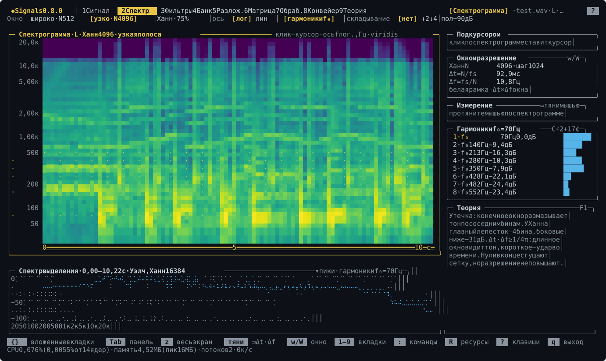

STFT, спектр выделения, пики, основной тон и гармоники. Вложенные вкладки — «Ресемплинг»: куда сложится спектр при ↓M, ↑L и L/M, — и «Тон и время»: растяжение без смены высоты и сдвиг высоты.

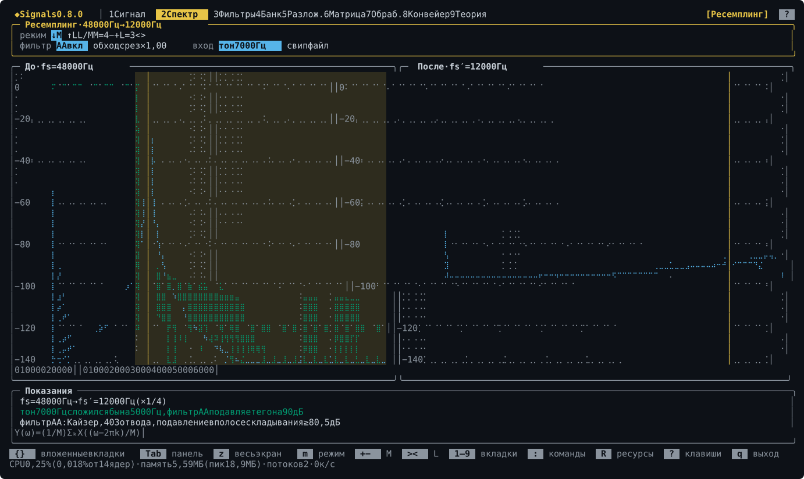

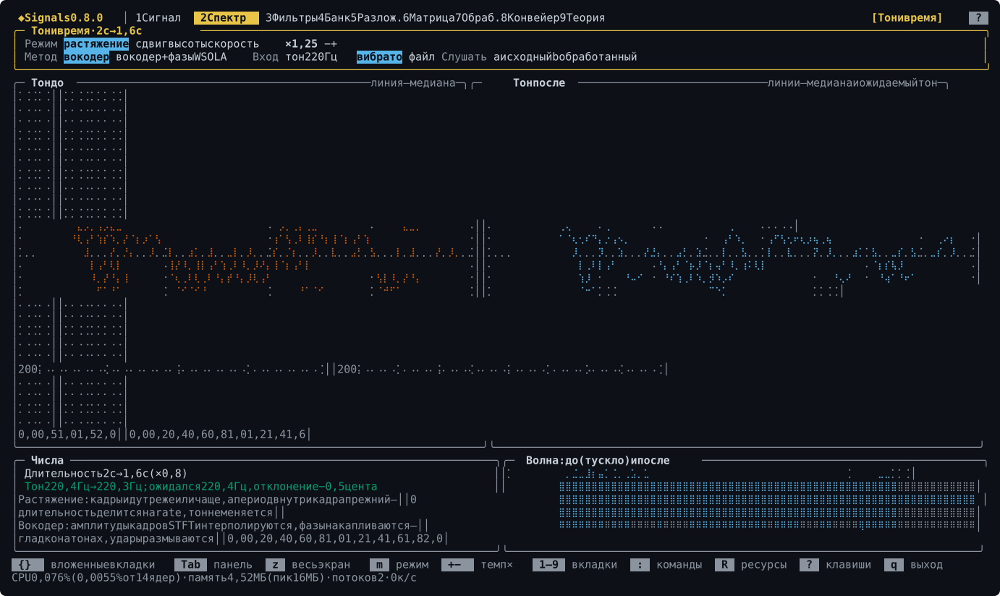

### Фильтры

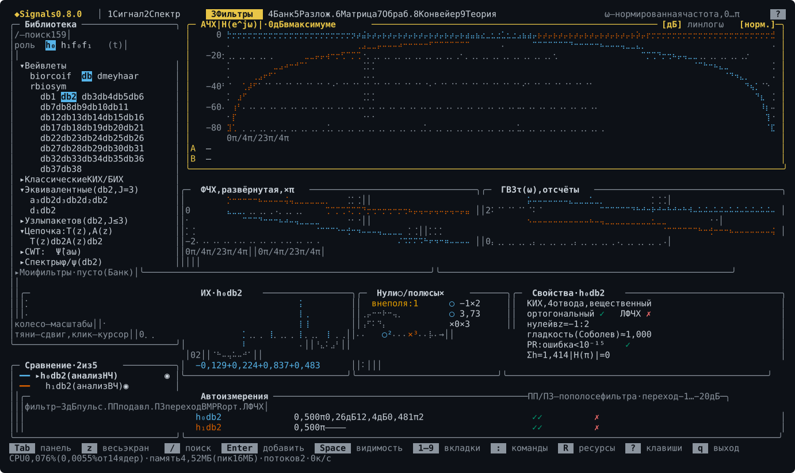

Все 106 вейвлетов PyWavelets, эквивалентные фильтры полос, сравнение до пяти фильтров: АЧХ, ФЧХ, групповая задержка, импульсная характеристика, нули и полюсы, которые можно двигать мышью.

### Банк

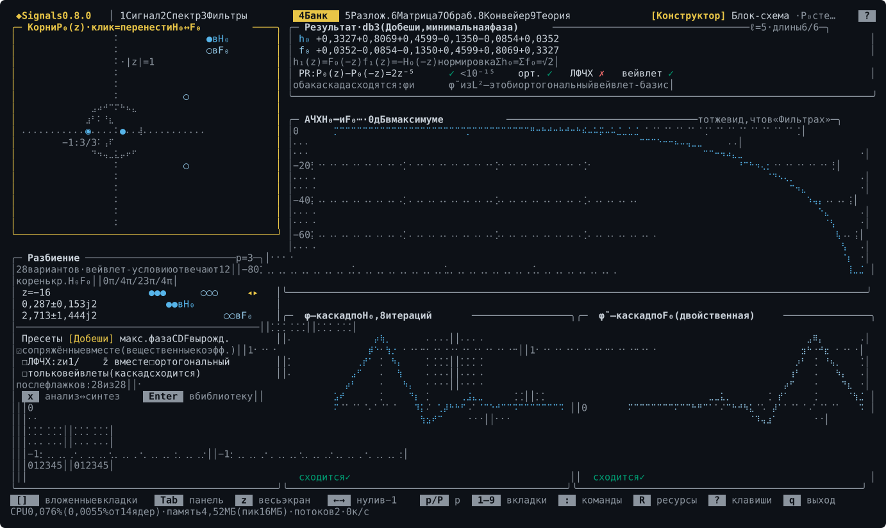

«Конструктор» раскладывает полуполосный P₀(z) на H₀ и F₀ по корням и проверяет полное восстановление; «Блок-схема» показывает банк со щупом на любом проводе. Ниже — перебор разбиений клавишей `n`.


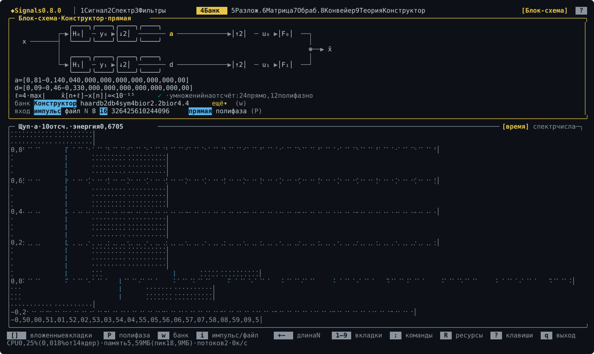

### Разложение

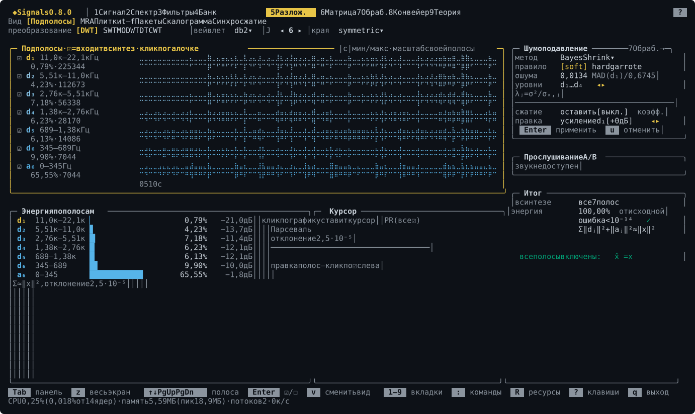

DWT, SWT, MODWT и DTCWT сигнала: подполосы, MRA, плитки время–частота, пакеты, скалограмма и синхросжатие, шумоподавление и правка полос с прослушиванием.

### Матрица

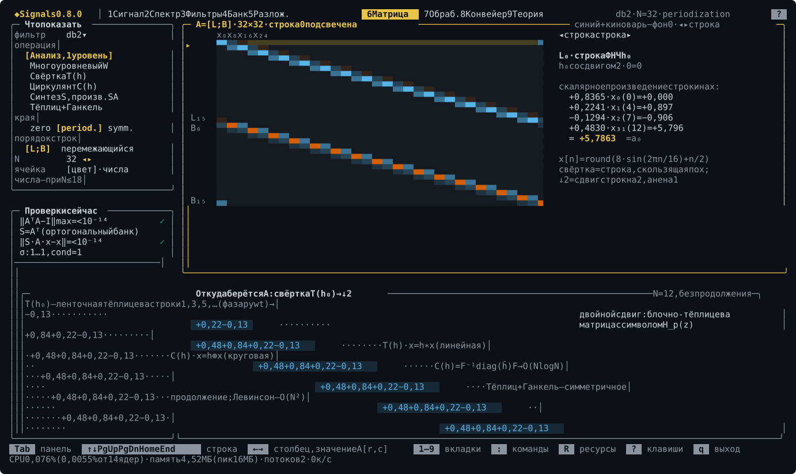

Тёплицевы матрицы банка, многоуровневая W, проверки AᵀA = I и сингулярные числа.

### Обработка

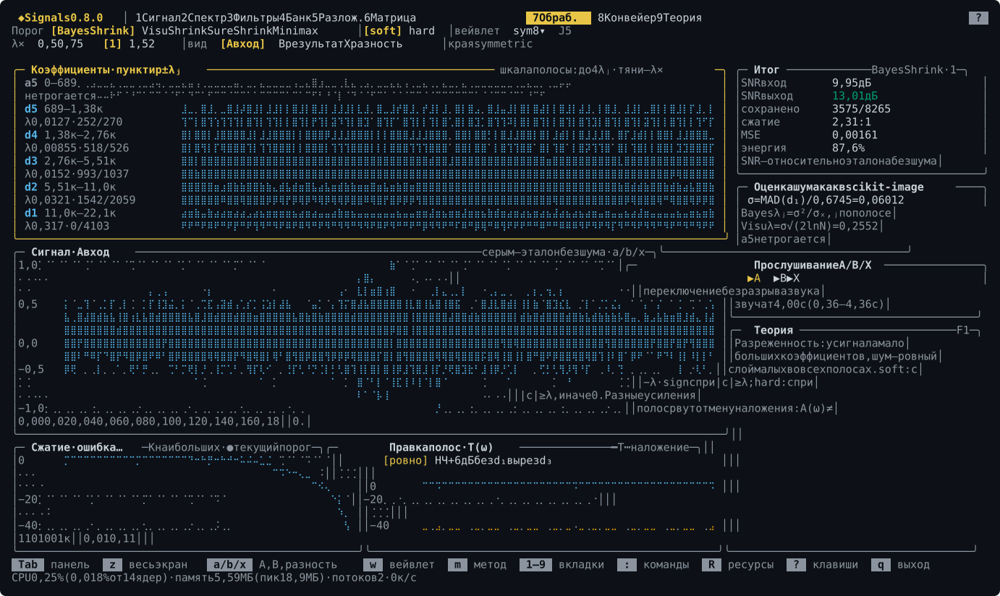

Шумоподавление фрагмента с эталоном: правила Bayes, Visu, SURE и Minimax, мягкий и жёсткий порог, кривая сжатия, сравнение A/B/X на слух.

### Конвейер

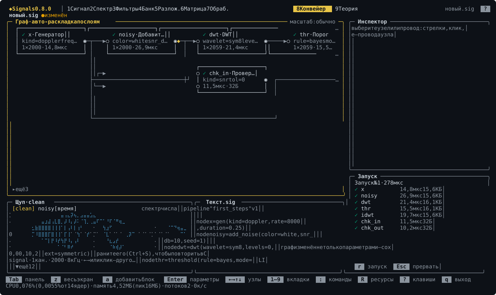

Редактор графов `.sig` из 136 блоков: граф раскладывается сам, у каждого узла видно время и память последнего запуска, щупы показывают сигнал, спектр или числа.


### Теория

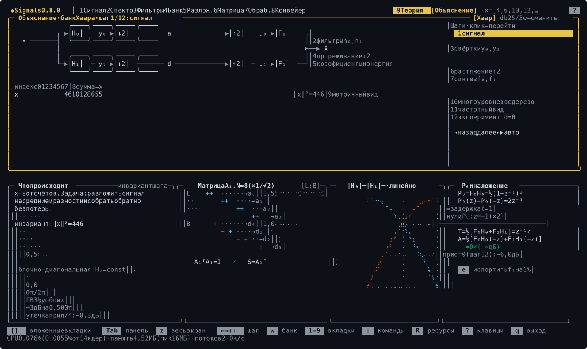

«Объяснение» проходит банк Хаара по шагам с числами в каждом узле. «Под капотом» — карточка каждого блока: формулы, те же формулы с числами открытого файла и код ключевой функции. «Учебник» — книга по разделам с поиском и формулами.

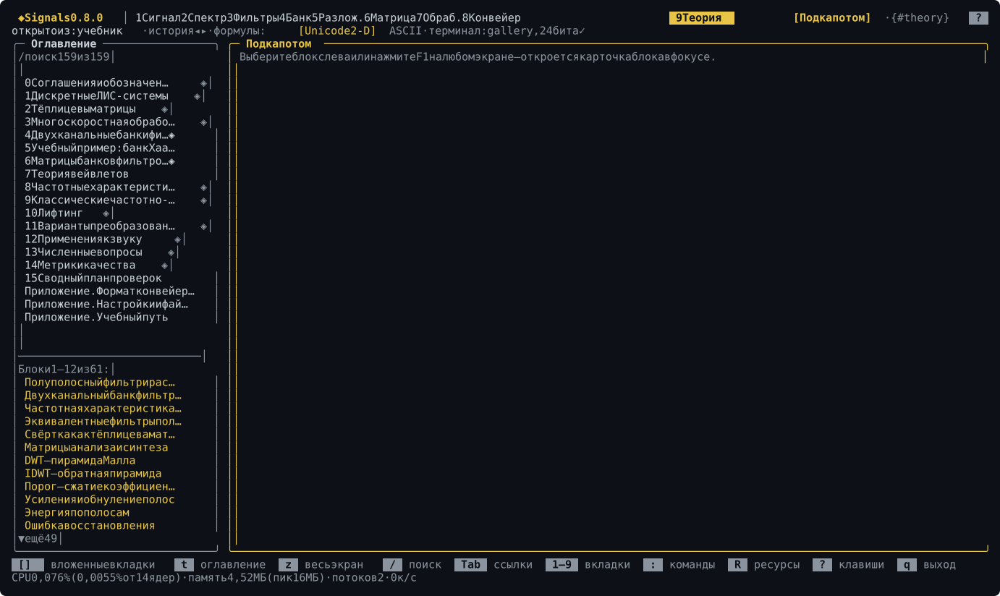

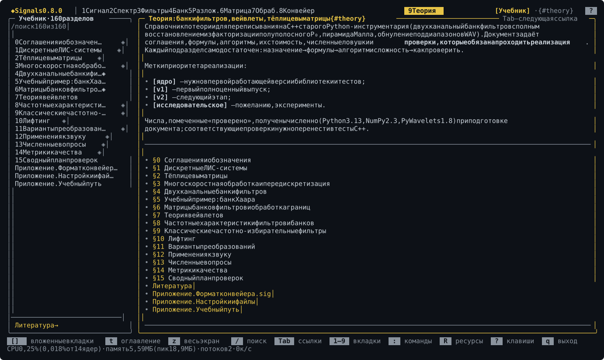

### Задания

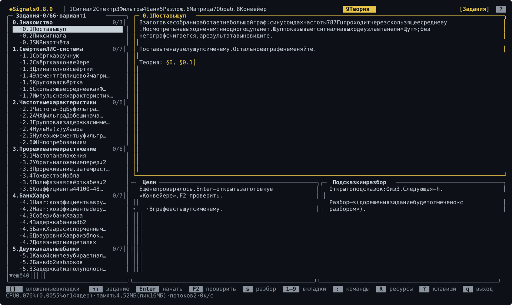

Учебный путь: 66 заданий в 12 главах, каждое программа проверяет сама. `F2` проверяет текущее задание с любой вкладки, `F3` открывает подсказку.


## Команды

Сообщения — на русском или английском: `--lang en` в любом месте команды или `SIGNALS_LANG=en`. Ключ `--json` есть у команд, которые печатают отчёт; `--help` у каждой команды перечисляет её параметры.

| Команда | Что делает |
|---|---|
| `signals check` | самопроверка ядра: восстановление, ортогональность, Парсеваль, дополнительность мощности, матрицы |
| `signals filter info <имя>` | коэффициенты h₀, h₁, f₀, f₁, задержка, нули в −1, гладкость |
| `signals filter response <имя>` | АЧХ, ФЧХ, групповая задержка и метрики фильтра или эквивалентного фильтра полосы |
| `signals design --p N` | все разбиения корней полуполосного P(z) и их классификация |
| `signals info <файл>` | формат и статистика каналов |
| `signals gen <вид>` | тестовый сигнал: sine, sweep, impulse, step, noise, harmonics, am, fm, dj |
| `signals resample <файл>` | ↓M или ↑M с фильтром Кайзера |
| `signals dwt <файл>` | многоуровневое DWT: коэффициенты в JSON, полосы — в WAV |
| `signals denoise <файл>` | шумоподавление вейвлет-порогом |
| `signals run <файл.sig>` | прогнать конвейер; `--set`, `-o`, `--probe-dir`, `--report`, `--values N`, `--watch`, `--json` |
| `signals sweep <файл.sig>` | серия прогонов по параметру узла |
| `signals graph <файл.sig>` | нарисовать граф текстом |
| `signals blocks`, `signals explain <блок>` | справочник блоков конвейера, описание одного блока |
| `signals learn …` | учебный путь: `list`, `show`, `start`, `check`, `hint`, `solution`, `variant`, `report`, `lint` |
| `signals completions bash\|zsh\|fish` | скрипт дополнения команд для оболочки |
| `signals man` | man-страница в формате roff |
| `signals tui [файл]` | интерфейс; `signals` без аргументов в терминале делает то же |

## Конвейеры

Обработку можно собрать из блоков и сохранить в текстовом файле `.sig`. Пример — [examples/first_steps.sig](examples/first_steps.sig), тот же, что открывает стартовая панель:

```text
pipeline "first_steps" v1

node x       = gen(kind=doppler, rate=8000, duration=0.25)
node noisy   = add_noise(color=white, snr_db=10, seed=1)
node dwt     = dwt(wavelet=sym8, levels=0, ext=symmetric)
node thr     = threshold(rule=bayes, mode=soft, levels=1..64, sigma=mad_d1)
node idwt    = idwt()
node chk_in  = check(kind=snr, tol=0)
node chk_out = check(kind=snr, tol=0)

x -> noisy -> dwt -> thr -> idwt
x -> chk_in.ref
noisy -> chk_in.in
x -> chk_out.ref
idwt -> chk_out.in
probe noisy as "noisy"
probe idwt as "clean"
```

`signals run examples/first_steps.sig` печатает SNR до и после: 10 и 19 дБ. Формат целиком — в [docs/user/sig-format.md](docs/user/sig-format.md), все блоки с портами и параметрами — в [docs/user/blocks.md](docs/user/blocks.md), остальные примеры — в [examples/](examples/). Расширение для VS Code с подсветкой и подсказками лежит в [editors/vscode](editors/vscode).

## Учебный путь

Задания с автопроверкой: собрать банк Хаара из блоков, найти задержку банка db2, сжать сигнал до 10 % коэффициентов, подобрать правило порога. Программа сама прогоняет граф, проверяет цели и подаёт в граф скрытые входы, поэтому подогнать ответ не выйдет. У каждого студента свой вариант чисел, а в конце — отчёт для преподавателя.

```bash
signals learn start 4.3            # заготовка 4.3.sig
signals learn check 4.3            # проверить граф
signals learn check 1.1 --answer "2 -3 0 7 1 -4"
signals learn report -o report.md
```

Свой курс пишется в тех же файлах, что и встроенный, и проверяется командой `signals learn lint --course папка`. Подробности — в [docs/user/learn.md](docs/user/learn.md).

## Документы

| Файл | Что в нём |
|---|---|
| [docs/02-theory.md](docs/02-theory.md) | книга: банки фильтров, вейвлеты, матрицы Тёплица, частотные характеристики; она же «Учебник» в программе |
| [docs/user/keys.md](docs/user/keys.md) | клавиши и мышь каждой вкладки — генерируется из кода |
| [docs/user/blocks.md](docs/user/blocks.md) | справочник блоков конвейера — генерируется из реестра |
| [docs/user/sig-format.md](docs/user/sig-format.md) | формат файла конвейера `.sig` |
| [docs/user/learn.md](docs/user/learn.md) | учебный путь: задания, варианты, отчёт, свой курс |
| [docs/user/config.md](docs/user/config.md) | папка настроек, файлы программы, переменные окружения |
| [examples/prak1](examples/prak1) | пример учебной работы: ноутбук и те же задания в Signals |
| [docs/03-design.md](docs/03-design.md) | проектный документ: цели, архитектура, этапы |
| [docs/04-backlog.md](docs/04-backlog.md) | запас доработок и предложение по версиям |

## Состояние

Готовы этапы M0–M10 (у M7 нет пиксельных формул): ядро банков фильтров, звук и командная строка, интерфейс со всеми девятью вкладками, теория в интерфейсе, конвейеры `.sig`, адаптивные фильтры, тон и время, синхросжатие и DTCWT, учебный путь и лёгкая установка. Ядро совпадает с PyWavelets на всех 106 вейвлетах и 9 режимах границ, классические фильтры — со scipy. Следующий этап — мост в Python: экспорт в `.npy` и скрипт на pywt и scipy по графу `.sig`. Версии идут за этапами: M9 — 0.8.0, M10 и M11 — 0.9.0; история — в [CHANGELOG.md](CHANGELOG.md).

## Разработка

```bash
cmake --preset dev
cmake --build --preset dev
ctest --preset dev
```

Сборка `dev` — отладочная, с AddressSanitizer и UBSan; на macOS она печатает при запуске безвредную строку `malloc: nano zone abandoned…` (убирается `MallocNanoZone=0`). Картинки экранов в README рисует сама программа:

```bash
cmake --preset release -DSIGNALS_BUILD_GALLERY=ON
cmake --build --preset release --target signals-gallery
build/release/tools/gallery/signals-gallery --out docs/images/en --lang en
build/release/tools/gallery/signals-gallery --out docs/images/ru --lang ru
```

Скрипты установки проверяются `packaging/test_install.sh` и `packaging/test_install.ps1`, формула Homebrew — `packaging/homebrew/test_render.sh`.

## Лицензия

MIT, см. [LICENSE](LICENSE).
